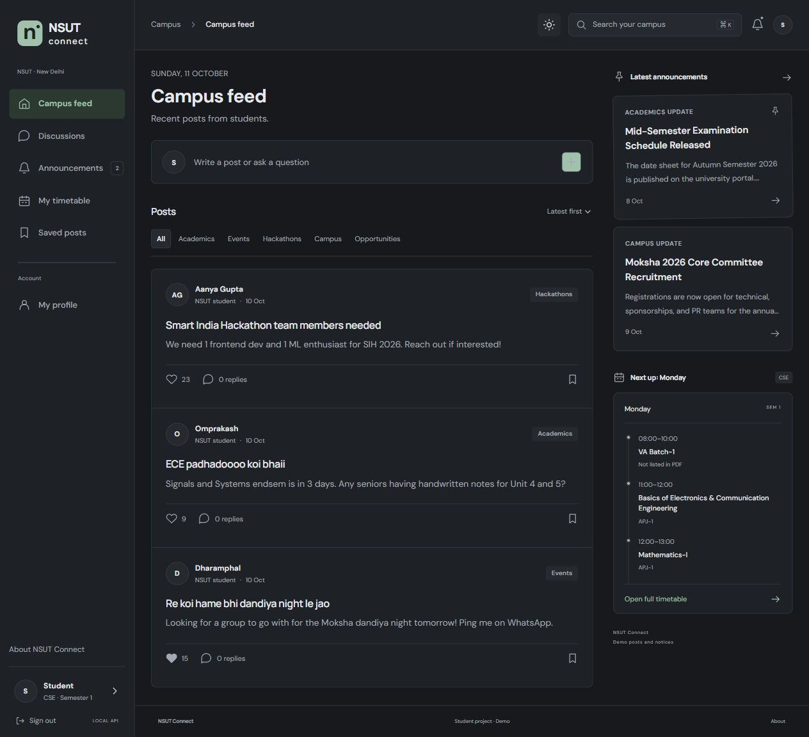

# NSUT Connect

A campus community project with Google sign-in for verified `@nsut.ac.in` accounts, discussions, announcements, timetables and light/dark mode.

Live app: https://nsut-connect-campus-yash.aizensosukeew345.chatgpt.site
Source: https://github.com/Omegaman-cell/nsut-connect



## Public app

The deployed app uses a React UI, a Cloudflare Worker API and a D1 SQLite database through Sites hosting. Google Identity Services supplies the sign-in button. The server uses `jose` to verify Google's signature, issuer, audience, expiry, a one-use login nonce, verified email and `nsut.ac.in` hosted domain. There is no public demo login or password login.

Sessions last 24 hours. The browser receives a Secure, HttpOnly, SameSite=Strict cookie; only its hash is stored in the database. Browser storage holds display state/preferences and offline snapshots, not an authentication credential. The server checks every protected request. Profile names come from Google on first sign-in and can then be edited.

Administrator emails are set with the server environment variable `ADMIN_EMAILS`, a comma-separated list of approved `@nsut.ac.in` accounts. Without an allowlist, every signed-in user is a student. The frontend cannot grant admin access. Changing the allowlist takes effect on subsequent server requests after the updated environment is deployed.

The initial notices and discussions are sample data. New posts, replies, likes, bookmarks and profile edits are shared through the database. Timetables are transcribed from the supplied July–December 2026 PDF: CSE (1, 7), CSAI (1, 7), CSDS (1, 5, 7), MAC (1, 5, 7). Section and elective alternatives are preserved; linked schedules not present in the PDF are not invented.

## Run the production server locally

Install Node.js 22.13+ and pnpm 11.25.0. In `hosted/`:

```powershell
pnpm install --frozen-lockfile
pnpm run build
node --import ./scripts/sites-env.mjs ./node_modules/wrangler/bin/wrangler.js d1 execute DB --local --config dist/server/wrangler.json --persist-to .wrangler/state --file drizzle/0000_natural_fenris.sql
pnpm start -- --port 5173 --var GOOGLE_CLIENT_ID:YOUR_CLIENT_ID.apps.googleusercontent.com
```

Apply that migration only once to a fresh local database. Local D1 data is separate from the public database. Register `http://localhost` and `http://localhost:5173` as JavaScript origins in your Google OAuth web client, then visit http://localhost:5173. A client secret is not used by this sign-in flow.

`frontend/src/` is the editable UI. `hosted/scripts/sync-client.mjs` copies it and the timetable seed into `hosted/` before builds. The hosted folder can also be deployed on its own using that prepared client copy. Sites provisions D1 and applies the tracked migrations during deployment; do not add database creation to request handlers.

## Original Python backend

The React/FastAPI starter is retained under `frontend/` and `backend/`. `start.ps1` and `stop.ps1` run/stop this version on Windows. Before starting it, set `GOOGLE_CLIENT_ID` and optionally `ADMIN_EMAILS` in the launcher terminal. It stores edits in `backend/runtime/data.json` and uses expiring bearer sessions. Demo access defaults to disabled and is enabled explicitly only by isolated tests. The public app uses the Worker backend because Sites runs Workers rather than Python.

## Features

- Campus Google sign-in, session restore and sign-out.
- Feed, discussion topics, category/search filters, sorting, posts, replies, likes and saved posts.
- Announcements and administrator create/edit/pin/delete controls; post ownership/moderation checks.
- Editable profiles, branch/semester/section selection, timetable day/week views and CSV export.
- Notifications with read indicators; responsive navigation; keyboard focus and modal controls.
- Persistent light/dark mode. Installable web manifest and cached public app shell; a signed-in visitor can view the saved timetable snapshot offline. This is a web app, not a native mobile binary.

## Checks

```powershell
cd hosted
pnpm test
node node_modules/typescript/bin/tsc --noEmit
pnpm run build
```

Eleven Worker tests cover Google token validation, campus/role restrictions, CSRF origins, session expiry/logout, SQL-backed posts/replies/likes/saves, ownership, admin announcements and timetable/profile validation. `backend/test_api.py` provides four isolated tests for the retained Python API. Successful campus sign-in still needs a real campus account; test fixtures do not bypass live authentication.

Read [CODE_GUIDE.md](CODE_GUIDE.md) for the code walkthrough and [DEPENDENCIES.md](DEPENDENCIES.md) for the full technology/package inventory.
